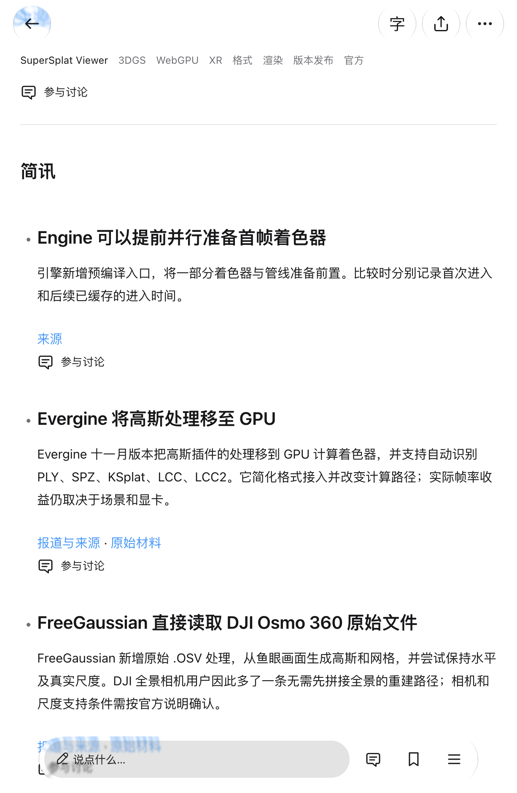
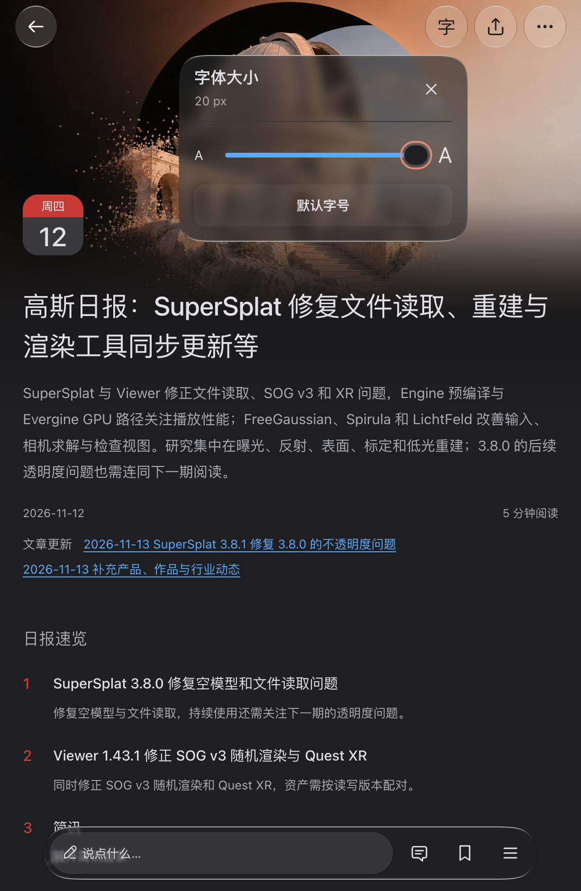
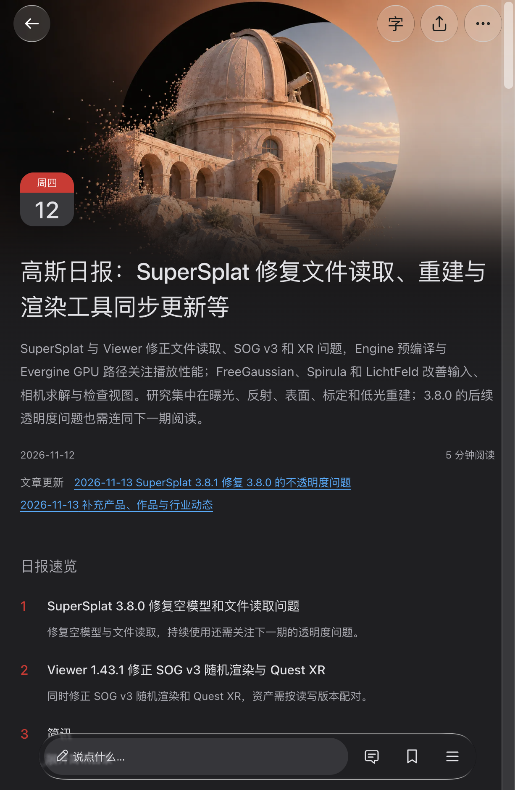

# 底栏、真正冷首开与字号修订结果

基线 `f49abcccfe4ceea2eaca3b6aedc907aec56789d9`，追加至草稿 PR #143，关联 Issue #137。生产继续保持 `11279e223d8ad4e50d5ff80222a63af739a3f9cf`。本轮没有改60期日报、5篇独立文章、9期周报及其原稿、ID、锚点、RSS GUID、讨论键；没有发布测试评论或改变定时任务。

## 已实现

- 底栏光学宿主放到工具栏同一fixed wrapper，使用明确的viewport→host映射；目标/宿主/背景在measure读取，paint不读布局。保留2×高光、真实折射、轮廓和safe-area，补visualViewport.scroll有界追踪。
- 原几何/union算法移到独立Worker；失败采用约4ms主线程分片，不整段同步回退。Worker片间使用MessageChannel，避免嵌套timer限制；有每订阅者取消、共享计划LRU与pagehide显式释放。
- 当前相邻两张材质就绪即可开始；后续资源不足保留完整帧及弹簧状态。GPU/encode/decode有各自队列和预算，当前、下一段、后台分级，后台不占首帧所需资源的优先级。
- 修复稳定布局缓存：实测两次打开只有0.00000191px或约0.0078px坐标差，旧key仍触发整个计划；现在相对位置与写入CSS的锚点按1/64布局网格统一，live placement保持连续。布局稳定门控仍要求两次一致测量，但不再额外多等一次。
- 字号14–20、步长1，手机/宽屏默认15/17；旧21–24收敛20并保存。正文、展开阅读、表格、图注和脚注跟随，文章与章节标题固定为默认响应式值，UI字号不变。
- 测试开关记录逐请求阶段、RAF队列等待与Long Task/LoAF；普通页面不提供诊断函数。`glassCold=1`仅在diagnostics启用时禁用预热，正常产品行为不受测试参数影响。

## 冷与热：最终构建的10组配对

场景为Mac Chromium、613×939、DPR2、11/12同一文章。每组cold新document、空应用计划/材质缓存、禁用预测预热，实际鼠标按住50ms再松开；again在同document关闭后重开。阶段耗时从click计，按住反馈与原定约200ms弹簧时长另计。网络缓存及GPU进程没有重置；基础按钮会在页面启动时按需启动PNG Worker，因此“菜单未预热”不等于浏览器/GPU全冷。

| 指标 | 冷首开 median / P95 / max | 再次打开 median / P95 / max |
| --- | --- | --- |
| 首个光学材质 | 111.7 / 124.8 / 124.8 ms | 19.7 / 26.7 / 26.7 ms |
| 内容开始显露 | 203.3 / 224.8 / 224.8 ms | 111.4 / 118.4 / 118.4 ms |
| 可交互 | 318.1 / 349.8 / 349.8 ms | 228.3 / 243.3 / 243.3 ms |

10组无超时、无页面身份变化、无>50ms RAF间隔。10次again全部命中计划缓存，新增材质均为0。达到本轮桌面冷首材质P95≤150ms、可交互≤400ms目标，**不等于iPhone已通过**。见 [acceptance-summary.json](acceptance-summary.json)、[cold-samples.json](cold-samples.json)。完整逐请求轨迹仅存本机 `.codex-work/cold-glass-evidence/`，避免用大量重复帧淹没仓库。

## 长帧归因与保留的反证

历史558.4ms记录只能证明scrollBy到下一RAF的墙钟间隔；该窗口generated保持5、GPU readback为0，render/encode/decode累计值不变。缺少该帧调用栈和索引，**仍未归因、未标为解决**。另一场景decodeMs约558是多个请求累计值，不能混为同一根因。

实施中保留了全部异常批次，见 [intermediate-cold-observations.json](intermediate-cold-observations.json)：

- 第一次10组冷首材质P95为160.7ms，未达标。已通过时间线发现Worker片间timer等待；改MessageChannel后下降。
- 后续20组中出现257.7ms与91ms RAF间隔。257.7ms样本中，材质早已准备好，前后advance/measure/paint均为几毫秒，约253ms发生在已请求RAF到回调交付之间。91ms样本对应LoAF 84.8ms、blockingDuration=0，Worker消息投递等待46.7ms、decode等待50.6ms与其重叠。现有证据不足以区分浏览器合成、调度、OS抢占等更底层原因，不写成主线程JS长任务。
- 同批慢样本可明确分阶段：trial11几何Worker启动/投递119.9ms、执行wall430.7ms，到click+592.5ms才完成；首张菜单材质随后仅14.6ms完成。后续一张小PNG编码wall另有164.2ms停顿，推高可交互至1047ms。queue检查未发现高优先级任务被仍排队的低优先级任务越过，budgetDeferred/failures均0。
- Worker的computeMs和decodeMs都是经过时间，可含线程抢占/GC/异步等待，不是独占CPU时间。10次带CPU采样的复测没有重现>50ms间隔。测试标签页后来被发现已切换文章；不能凭此断言此前异常来自用户操作。后续改用独立4357来源，并增加每个样本URL/title/timeOrigin前后核验。
- 确定且已修的额外负担是17/20次again因细微位置差重新规划、生成15张图；最终10次全部命中。原轮廓fixture SHA-256仍为 `dc8a7fc5bd8a2cbe7992a5f41ad4f7975fd47969452c02f4b2bf5251acc820eb`。

最终批次没有重现这些异常，只说明该批次的结果，不证明历史558ms或所有系统调度停顿已消失。若iPhone仍有追赶，保留测试版本，按设备时间线继续定位。

## 验证与边界

- 194项站点测试及43+25项Python测试；类型、编辑、内容/来源覆盖/媒体、静态构建与导出检查通过。99 HTML、3 RSS、60原稿，无断链/资源/锚点问题。两种Worker独立JS资产及其字节一致性检查通过。
- 底栏939→820→939高度变化、非零位移及0.85/1.05缩放时，宿主与bar同链，中心误差最大约0.0043 CSS px；paint无布局读取。见 [toolbar-coordinates.json](toolbar-coordinates.json)。这不是Safari地址栏真实合成像素的替代证据。
- 浏览器实测14/15/16/17/20正文变化，所有h1–h4测量值不变；旧24回写20，reset恢复默认且焦点回字号按钮。见 [font-ranges.json](font-ranges.json)、[font-migration.json](font-migration.json)。
- 连续退出q=.75/停住保持/反向.875通过；四宽度Swiper快甩/横滚/反向/重抓、5张玻璃背景稳定误差0。见 [browser-regressions.json](browser-regressions.json)。
- 从首页卡片进入→更多菜单加入稍后读→独立收藏→目录/讨论切换→回来源，活动卡与焦点恢复；最后一项移除/撤销/再移除后入口隐藏且焦点回更多。讨论只验证真实入口/加载，未登录或发测试评论。
- Worker不可用时菜单可打开，fallback计算片约2.4–7.4ms，无>50ms RAF；可交互约1秒，作为降级路径记录，不算正常Worker性能达标。减少动态/透明度时0可见光学副本，普通页面diagnostics为undefined，控制台无相关错误。
- Astra High独立复核提出的两个P2已修：首pair未ready不能借resting map闪全尺寸；BFCache原生listener间microtask竞态通过capture保存请求、再dispose，pageshow重启。独立复核确认关闭。真实iPhone、Mac触控板及iPad/折叠屏本轮物理验收未取得，不能以浏览器/fixture替代。

## 交付

实现分为两个可审查提交：`59d274b`（正文14–20及标题固定）和 `2798315e9247f243f7f462a408fa78c56ed33a7c`（底栏同宿主、异步冷首开、回归证据）。后续交付记录为文档提交，不改变本次测试构建。

- [4337本地预览](http://127.0.0.1:4337/horizon/)已切到冻结构建 `toolbar-cold-2798315`，[本地回读](local-readback.json)核对内容哈希、搜索、3份RSS及sitemap通过。
- [独立在线测试页：11月12日](https://6afb1d9a6971115ddf573d2e--creative-kitsune-db27b4.netlify.app/horizon/daily/2026/11/12/)；部署ID `6afb1d9a6971115ddf573d2e`，`deployment.json`为2798315，[在线回读](online-readback.json)通过。
- [实际实现SHA的CI](https://github.com/Shuang-su/Metaflow-Horizon/actions/runs/43893968097)已完成并成功。草稿[PR #143](https://github.com/Shuang-su/Metaflow-Horizon/pull/143)仍未合并。
- 线上浏览器回读确认字号min/max为14/20、底栏与光学宿主同父容器、WebGL2折射启用、普通页面无诊断接口；菜单收回后重新检查稳定画面。

已向用户提供这一个新部署的iPhone验收链接。等待Safari地址栏展开/收起、慢滚/停住/反向和冷首开的实际设备反馈。生产继续保持 `11279e223d8ad4e50d5ff80222a63af739a3f9cf`，不合并、不提升、不计入08:00定时成功；旧0fe1989构建保留为测试回退点。
