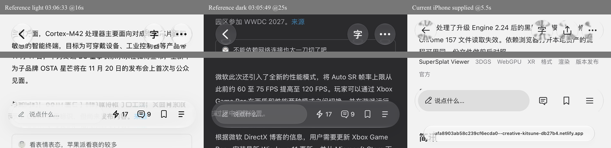
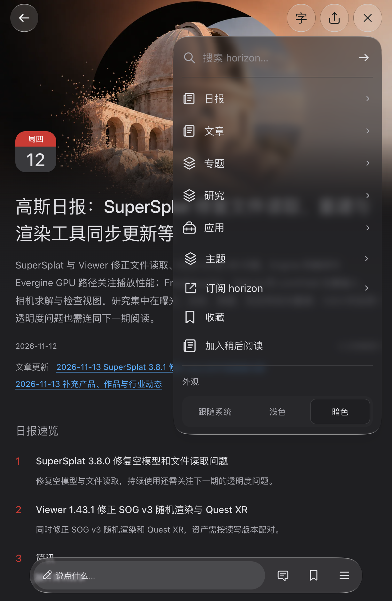
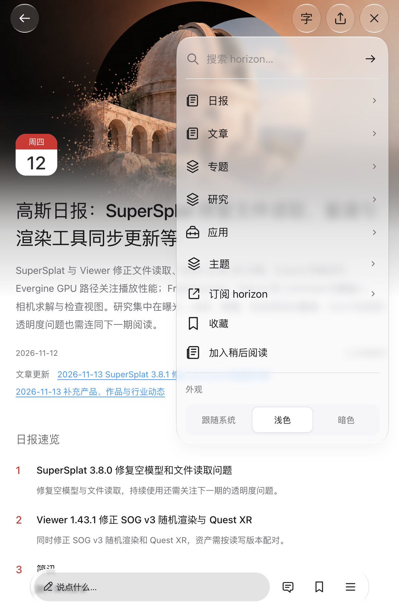
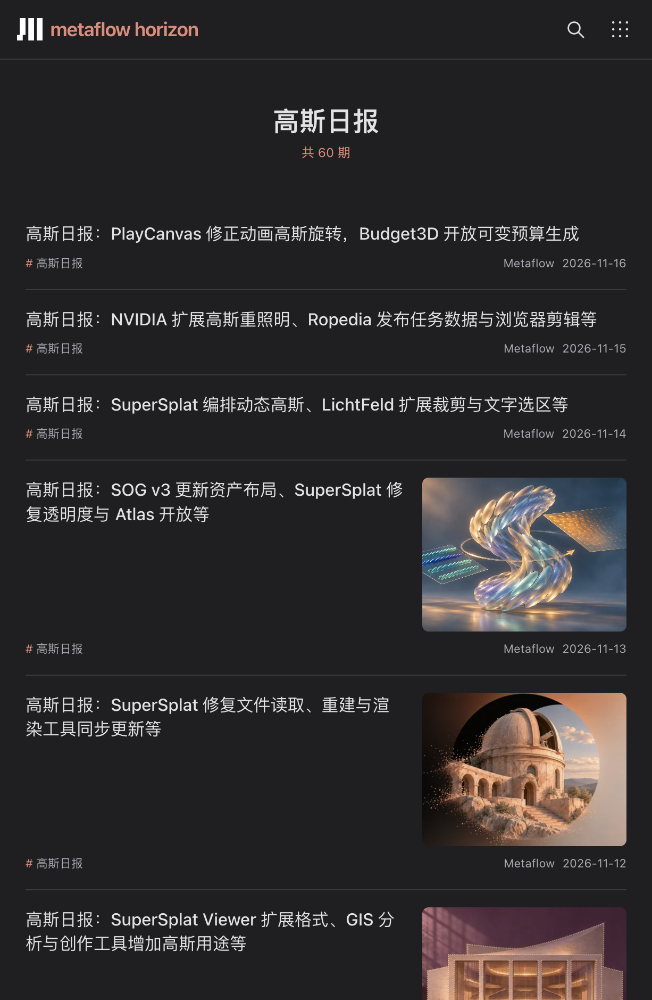

# iPhone反馈后的追加修订（11月16—17日）

基于 `b343d78`。用户在6afb1d9a预览上确认底栏错位“基本好了”，同时指出底栏不退出、更多菜单卡顿、材质希望更贴近参考，以及合集返回后的选中框/下划线。此前完成记录保留为第一轮证据；本文为追加结果。本轮不合并、不提升生产。

## 实际修复

1. 底栏原先没有订阅顶部按钮的共享q。现将本地光学宿主、内胶囊和图标放在同一个motion容器，读取同一次q采样，下移、淡出、等比缩放一起发生；q=0时inert，反向从当前位置恢复。fixed外层、safe-area、目录抽屉原有行为不变。实测q=0/.5/1与顶部一致，光学局部映射在视口改变和缩放时最大中心误差约0.0043px。
2. More原先没有预测预热，且750ms无条件结束动画。已增加真实同布局隐藏预测、become/neck0原参数及状态保护；预热集合按sourceId隔离，不覆盖字号计划。普通页面两种预测可同时保留，冷测试完全禁用。
3. 复杂字号路径先发送已确认的首对stop，随后按Worker slice发送增长前缀；原最终轮廓逐字节不变。不按前缀重新归一进度，走到未知段保留完整帧；取消、反向、重开、Worker失败与BFCache均保留正确接续。
4. More静止shape原用offsetHeight=623，而规划使用622.938，两个key各生成6,621,120B的相同尺寸贴图。重复终点使总资源超过16MiB预算109,016B，产生8–10次驱逐及重建。统一为getLayoutSize后稳定集合10,265,112B，最终10组零驱逐，重开零新增材质。
5. More原来要求位置误差绝对值<1px才开放交互。稀疏RAF可能从尚未到位直接采到正常过冲，错过首次窗口，多等约220–250ms。现在只要完整轮廓已包含内容且其余geometry/material/content门槛通过就开放，原弹簧继续回落；没有缩短弹簧或跳过Gooey。
6. 触摸/鼠标返回仍恢复来源链接焦点，但不显示程序恢复造成的整卡选中框；标题hover不加下划线。下一次键盘操作立即清理quiet标记，正常键盘focus-visible保留。实测返回11/13链接焦点保留、link/card outline与underline均none，Tab后的下一链接为solid focus。

## 材质对照

按03:06:33、03:05:49及13/15录屏的10bit BT.2020/PQ信息抽取有限SDR帧。只比较形状及局部对比，不反推HDR绝对亮度。参考本身也有明显边缘弯折，问题是中心正文倒影过于可读、长边高光过强。

- source preblur：顶部0.95→1.35px，底栏1.2→1.8px；原32/26折射幅度和2×材质不变。
- 原rim仅调整合成gain：toolbar0.80、menu0.85，不模糊rim、不改shader或轮廓裁切。
- More tint单独0.64→0.58；字号填充保留。暗底栏改为white×0.10，内“说点什么”半透明胶囊按用户要求保留。

## 冷启动数据与反证

完整汇总见[followup-performance.json](followup-performance.json)。Mac Chromium，613×939，DPR2，真实mouse down/up 50ms；cold新document/应用缓存、关闭预测预热，网络与GPU进程缓存未清。字号cold额外在click时启动45帧、每帧2px背景滚动；warm为同文档关后重开。数据不能代替iPhone。

| 最终10组 | 首材质median / P95 / max | 可交互median / P95 / max |
| --- | --- | --- |
| 字号cold＋并发滚动 | 100.7 / 103.7 / 103.7ms | 326.0 / 342.6 / 342.6ms |
| 字号warm | 20.1 / 20.5 / 20.5ms | 228.3 / 236.9 / 236.9ms |
| More cold | 66.2 / 68.5 / 68.5ms | 402.4 / 423.1 / 423.1ms |
| More warm | 22.6 / 26.4 / 26.4ms | 358.7 / 374.0 / 374.0ms |

这40个最终样本无超时、无>50ms RAF间隔。字号达到原P95≤150/400ms目标。More相较第一次实测的896.1ms已有改善，但423.1ms仍高于同一400ms目标23.1ms，不写成全部指标达标。常规开启预测时单次More首材质38.3ms/可交互383ms，零新增材质；该值另列，不代替cold。

保留失败和中间样本：旧在线并发滚动字号P95 225.3/425.2ms；初版stream有161.2ms首材质及418.5ms可交互。后者包含一次125ms长任务，已由同一请求时间线准确定位到#14/#15的同步readback span：394.3→519.4/519.5ms，atlas555,408B。编码Worker本身同时只耗2ms，127ms decode等待横跨主线程忙碌，不能当纯解码计算时间。现已细分atlas分配、getBufferSubData和band解包trace；最终批次未复现，尚不能将125ms进一步断言为某个驱动或分配步骤。

历史558.4ms仍缺少对应栈/帧索引，不能把这次125ms或另一批累计decode值回填为其根因；继续标为未归因。

## 验证与发布边界

Astra High实现/分析与独立复核分别完成：底栏/quiet focus未发现P1/P2；流式前缀、部分取消、失败回退、BFCache及final同对象接续通过独立复核。最终终点去重、包含式交互门槛与rim alpha也通过独立静态复核。浏览器验证顶部/底栏退出反向、局部宿主resize/scale、More和字号开合/取消重开、两种预测同时保留、明暗主题、合集来源焦点与键盘提示。无相关控制台错误。

207项站点测试、43+25项Python、类型、编辑、60期原稿/内容/来源覆盖与媒体验证通过。静态构建与导出检查通过，99HTML、3RSS、60canonical reports，无内部链接/资源/锚点错误。构建没有改变稿件与分享图；仅本轮生成的三份分享图衍生漂移已恢复。实际最终SHA的CI和测试部署回读在PR交付中记录。

最新测试部署需重新由用户在iPhone检查底栏同步退出、More手感与调整后的材质；上一版“基本好了”仅对应上一版对齐反馈。原始录屏、完整逐请求时间线仅存本机cache；本轮没有发评论、合并或动生产，也不计为定时发布成功。

## 最终交付回读

- `2b36710`：触摸返回卡片quiet focus及移除标题hover下划线。
- `729a7abea3cf421ddea2ae0c4f16fff38f30e870`：共享底栏退出、More预热/材质去重/首个交互门槛、流式路径与材质对照。
- [实现SHA的CI已成功](https://github.com/Shuang-su/Metaflow-Horizon/actions/runs/43907194782)。
- [最新iPhone测试页](https://6afb2e96a1283402df46f47f--creative-kitsune-db27b4.netlify.app/horizon/daily/2026/11/12/)，Netlify draft `6afb2e96a1283402df46f47f`，build commit729a7ab；[线上内容/搜索/RSS/sitemap回读](followup-online-readback.json)通过。
- [4337预览](http://127.0.0.1:4337/horizon/)切至冻结构建 `toolbar-followup-729a7ab`；[本地回读](followup-local-readback.json)通过。旧2798315及0fe1989测试构建保留。
- 线上真实页面确认WebGL2折射、底栏motion本地宿主、字号14/20/1、正常页面无诊断接口；More开合与字号菜单可用。
- 两个生产地址的deployment.json再次回读均仍为11279e2，PR #143保持draft，不合并。已将新预览链接交给用户继续iPhone验收。
